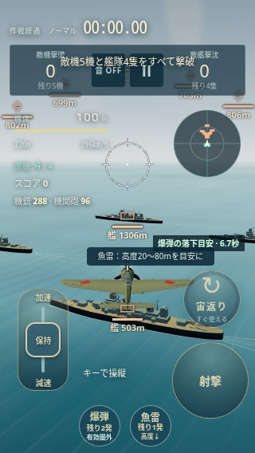
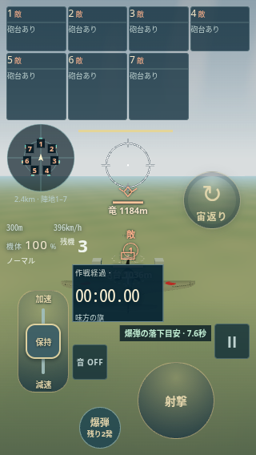
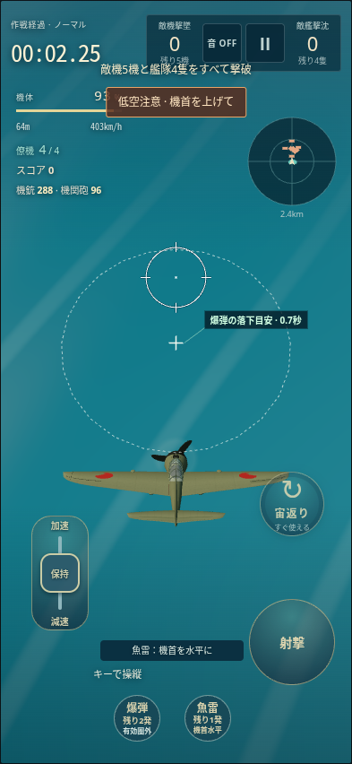
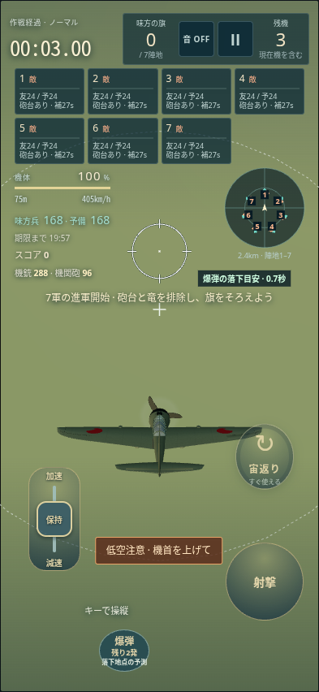

# カイセン基準のUI：P0画面比較と差異分析（2026-10-20）

**カイセンのUI構成を復元し、その構成を保って7陣地を加える。配置探索の完成を開発目標にしない。** [修正計画 PR #22](https://github.com/chameleonjp-lab/fantasia/pull/22) に沿って、比較を先行する段階へ戻しました。

このPRのmainに対する製品・テスト・CI差分は0です。#23の先行コード `601df780` と以後の未採用案を保存し、P0の提出内容から分離しました。資料の完成とUI修正の完成を区別します。

## 比較の基準と範囲

| 対象 | 固定SHA | 扱い |
| --- | --- | --- |
| Kaisen main | `6118b7868b72315bd52106da4326f9f00f91814c` | 共通UI・操作の基準 |
| Fantasia main | `f8264c530c213f0a66c6454d5fe3de619ea86c9a` | 修正前 |
| Draft #20 | `e60c7a0a2ebb1c153c6a23f13c91e1bfff2f16e6` | 未採用候補 |
| Draft #21 | `69d70a55c1bb513f0fcd1ad09af237b78d1ed3ba` | 未採用候補 |

[原寸画像132件と条件別一覧](evidence/kaisen-ui-foundation-20261020/p0-completion/README.md)：飛行中64、代表8画面32、4姿勢16、境界条件の停止・設定・結果16、実低空警告4。画面IDの数で、テスト132ケースの意味ではありません。同一環境・同寸法・同モード・同文字倍率で目視比較しました。

飛行中は393×852／852×393／320×568／568×320、100/200%、Normal/Easyの全組合せ。代表8画面・4姿勢は393×852・100%。境界画像で320×568の停止・タッチ設定と568×320のキー設定・結果を200%で追加しています。未撮影の全状態・全寸法の直積まで合格とはしません。

環境はLinux、Chromium 154.0.8037.57、実WebGL2／SwiftShader、DPR 1。200%は各DOM要素の計算済みfont-sizeを2倍にし、全体zoomは使いません。Canvasの文字は既存の描画実寸です。iPhone実機・Safari・通常時計の性能の証明ではありません。

## 画像から確認した差異

320×568・Normal・100%。Kは時計と集計・操作を上部にまとめ、計器を左、レーダーを右に置いています。Fでは時計が詳細欄へ入り、モード・残機・音・停止・計器が分散しています。

| カイセン | Fantasia main（修正前） |
| --- | --- |
|  |  |

[#20の同条件](evidence/kaisen-ui-foundation-20261020/playing/pr20-320x568-normal-100.png)／[#21の同条件](evidence/kaisen-ui-foundation-20261020/playing/pr21-320x568-normal-100.png) でも、共通UIのまとまりは回復していません。200%ではさらにボタン・レバーが移動します：[#20](evidence/kaisen-ui-foundation-20261020/playing/pr20-320x568-normal-200.png)／[#21](evidence/kaisen-ui-foundation-20261020/playing/pr21-320x568-normal-200.png)。

| 対象 | 共通UIに一致する部分 | 意図しない差異・是正方針 |
| --- | --- | --- |
| 上部HUD | 393×852・100%の時計、集計パネル、共通の色・枠 | compactで時計が詳細欄へ入り、残機・モード・音／停止が独立移動。Kの視線順とまとまった親領域を復元する。 |
| 計器 | HP、バー、高度・速度、得点・弾数の部品と文字階層 | 狭幅・横画面でHPとバー、高度・速度、弾数がばらばらになる。左の計器群を保ち、本作情報を追加する。 |
| 操作ボタン | 操作種別・既存の設定編集・入力方式 | FのCSSとHUD配置がK由来の設定位置・寸法を上書きする。保存値と実hit targetを所有する共通処理へ戻す。 |
| 照準・機体 | 既存の照準投影、機体モデル、カメラ計算 | HUDの被りを直すために照準・機体・カメラを変更しない。中央の実照準と航空機・操縦の空間を先に確保する。 |
| レーダー | 円形表示、距離情報の表現 | 320縦では左、568横では中央寄りへ移動。Kの右側の補助領域を維持し、7陣地等の内容だけを差し替える。 |
| 文字 | 共通色、実ブラウザで使用されるCJK／数字フォント | 200%で制御ラベルや数値が重なる。K自身の200%崩れも記録し、縮小・欠落や独自テーマで回避しない。 |
| 警告 | 低空警告の色・枠と文言 | Kの上部の安全警告が、Fでは下部の操作付近へ移動。警告の優先度と共通領域を継承し、作品の意味だけを追加する。 |
| 設定・停止・結果 | 共通パネル、保存／破棄、再開・ホームの導線 | 共通構成を作り直す必要はない。#20/#21のEasy説明に残る非搭載「魚雷」は除く。Kの停止中に残る作戦案内も、正しい安全動作とは扱わない。 |

操作の実測例（既定設定・100%、中心x/yと幅×高さ、CSS px）。これは保存操作の受入を代替する数値ではなく、画像の差の説明です。

| 条件・操作 | Kaisen | Fantasia main |
| --- | --- | --- |
| 393×852・宙返り | (326.2, 562.3) / 72×72 | (326.2, 562.3) / 72×80.7 |
| 393×852・爆弾 | (153.3, 800.9) / 52×52 | (153.3, 800.9) / 62×52 |
| 320×568・宙返り | (265.6, 374.9) / 72×72 | (265.0, 250.0) / 72×72 |
| 320×568・射撃 | (264.0, 477.1) / 96×96 | (220.0, 500.0) / 96×96 |
| 568×320・速度レバー | (96.5, 240.0) / 51.2×102.4 | (445.6, 223.2) / 51.2×102.4 |

低空警告は実入力による発生時を比較しました。Kはtick135、Fの3版はtick180。Kの海面とFの地形、初期高度の違いがあり、海抜高度・tickの同一性を警告条件とはみなしません。

| カイセン | Fantasia main（修正前） |
| --- | --- |
|  |  |

## 許容する本作差分と、変更しない基準

7陣地の番号・owner・争奪・進捗・兵数・予備兵・次波、残機、地上軍、期限、魔法・竜・砲台、爆弾の対象情報、戦役の結果・得点は本作データです。魚雷を持たないこと、陸上の背景、初期高度や敵の状態の差もゲーム内容です。時計・計器・操作・警告を別々の場所へ移す理由にはしません。

モデル2ファイルと照準投影はKとFで同一bytesです。カメラの定数と計算は同じで、コメントを除いてTypeScriptから出力したJSも同一（SHA-256 `95be99424871bd146fbf95a7324b40a446dbac52aaf6a9a74f71e6a95b5a7721`）。[4版×4姿勢](evidence/kaisen-ui-foundation-20261020/p0-completion/README.md#4姿勢16画像)も確認しました。地上戦・カメラを変更する作業へ広げません。

元計画のK UI継承、7陣地、100/200%・縦横・小画面、入力解除、実画像の条件を保持します。後続の「発生中の警告は詳細欄外で全文」「採用済みの詳細限定スクロールと中立入力」も保持します。現在の探索で使った座標・矩形サイズ・探索回数を、ユーザーのUI要件へ置き換えません。

現行矩形の面積不足や配置失敗は、Kの構成で両立不能である証明ではありません。まず共通の領域を復元して実画像で評価します。優先順位の変更が必要と分かった条件は、画像と不足を示して判断を求めます。「砲台あり」を詳細へ移す以前の提案は採用しておらず、このP0では情報を移動・削除していません。

## 次の小PRと受入

1. **P1：共通HUD・操作の復元。** Kの時計・集計・音／停止、左の計器、右のレーダー、照準、既存の操作・保存配置を基準にする。個々の部品を探索で散らす構成から離れ、共通の親領域と少数のレスポンシブ規則へ戻す。Fのゲームルールやカメラは変更しない。
2. **P2：固有情報・警告の追加領域。** 7陣地を上端の7列／狭幅4+3へまとめ、共通領域と操縦空間を保つ。重要警告は詳細外で全文、詳細は既承認範囲だけ。復活待機の解除・復元と保護表示の重複もこの範囲で引き継ぐ。
3. **P3：正式検査と画像レビュー。** 元の34件、速度レバー4件、活動警告12件（計50件）、カメラ2件、UI-only15件と保存配置の候補4件を減らさない。44px、既存の誤差許容、200%実文字、全文・中立入力、回転・再開・復活の条件を緩めない。各PRに同条件のK／修正前／修正後画像を載せ、成功・失敗・未実施を分ける。

P1/P2はこのP0で修正済みとはしません。新しい巨大な常駐パネルや全体縮小へ置き換えず、旧探索案の調整を再開しません。マージ・公開は利用者が判断します。

## 検査記録と保存

- P0の元ファイルと製品・テスト・CIのmain一致を照合。`npm test` は487 passed / 0 failed / 0 skipped、build成功、UI source integrityは3 passed。製品がmainと同じである確認であり、UIの修正成功ではありません。
- P0の実DOM検査は7 passed / 1 failed。mainと同じ製品コードで元のHUD集約ケースが12秒上限へ到達。上限・assertionを変えず失敗を保持しました。カメラ2件は実レンダラーで2 passed。原log・JSON・画像・configは新メタデータの `p0Verification.files` に可逆保存しています。
- 補完44画像はpage errorなし、各参照に未コミット差分なし、撮影前後tick不変。PNG bytes／SHA-256を全件照合済み。[原データと撮影スクリプト](evidence/kaisen-ui-foundation-20261020/p0-completion/README.md#原本と再現)。
- 先行#23の[CI #129](https://github.com/chameleonjp-lab/fantasia/actions/runs/39414813598) はUI-only 6 passed / 2 failed。ホーム検査中の再読み込みと、200%の操作ラベルoverflowを含む失敗を保存し、取り消しません。
- `601df780` の正式34件は14 passed / 20 failed、速度レバー2/4、活動警告0/12、追加保存配置4/4、カメラ単独2/2。[当時の完全ログ・JSON・画像](evidence/kaisen-ui-foundation-20261020/tests/README.md)を保持。初回34件の画像を後続出力で失った経緯と、出力を分けた再実行も記録したままです。
- 以後の未採用作業は[保存アーカイブ](evidence/kaisen-ui-foundation-20261020/unaccepted-attempts-20261020.tar.gz)（18,351,639 bytes、SHA-256 `6f35e206e29ee18aecfe26a8c2f8f3a464ddebc35795e7f71e515a78d06e1a9e`）。全105ファイルを照合し、未採用パッチ、CI原artifact、原JSON・画像・ログを保持。最後の単体実行は563中557成功・6失敗で、その後の差分は未検証です。P0の成果や成功結果へ混ぜません。

#20/#21/#22の履歴・検査ファイル・状態は変更していません。旧P1の新規検査も `601df780` と履歴に保存し、P0のために検査基準を弱めてはいません。P0の資料を採用しない場合は、このDraftを閉じれば製品への影響はありません。資料だけを戻す場合はこのPRのdocs差分をrevertし、保存形式・ユーザーデータの移行は不要です。
