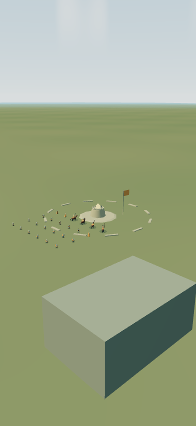
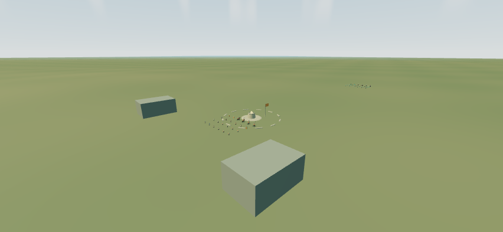
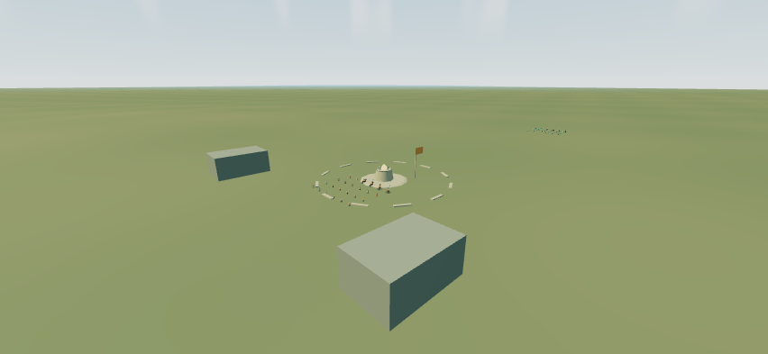

# NPCカメラ補助と拠点・砲台の拡大

兵士4職と竜は照準・Easy自動射撃の対象に残し、カメラを寄せる強さを0にした。友軍は従来から対象外。砲台への強さ0.25と、選択した同じ標的を射撃まで保持する仕組みを維持した。

拠点の旗・広場・外周・砲台を線寸法1.5倍にした。砲台の照準点・発射点は地面から9m、弾の命中半径は9m。外周の地形高さは拡大後の座標で求める。占領半径55mは従来のまま。旧サイズの記録と混同しないため、地図の識別子を `fantasia-sevenfold-v2-large-sites` に更新した。

## 表示比較

比較元はmain `d797962af3634f44a381824cdd1aa3f688385e3e`。同じThree.jsの描画処理と、固定した検査用カメラを使った。カメラ位置は `(870,86,140)`、向く位置は `(1000,22,0)`。縦393×852、横852×393で撮影した。実際の出撃操作やiPhone Safari実機の検査を示す画像ではない。

| 画面 | 変更前 | 変更後 |
| --- | --- | --- |
| 縦画面 |  |  |
| 横画面 |  |  |

数値は [model-evidence.json](model-evidence.json) に保存した。7拠点すべてでクリスタル中心と砲台の照準点が一致し、旗の高さは3.2mから4.8mになった。拡大後の外周は地形に接地する。砲台を破壊するとクリスタルが消え、高さが元の0.35倍となり、復旧時には拡大した通常表示へ戻る。

## 検査

`npm test` の474件、`npm run build`、`git diff --check` を通過した。描画コードの変更に合わせ、UI検査の固定SHA-256を1箇所更新し、アンカーと検査条件は維持した。`npm run test:ui-integrity` の3件も通過した。

独立担当が追加診断で、NPCへの小入力・射撃を含む2400tick、砲台からNPCへの標的切替、画面外の旋回応答、7砲台の発射位置と命中半径の境界、大径砲台の7方向の回転と配列逆順、旧・新地図の記録分離を確認した。修正必須の指摘はなかった。画像4枚も実見した。

UIの全検査結果は、この変更依頼に紐づくGitHub Actionsの結果を参照する。ローカルでは別バージョンのChromiumを使用したため、標準ブラウザの検査とは区別する。
